<div align="center">

<a href="https://syamaydev.github.io/muslimweb/">
  <picture>
    <source media="(prefers-color-scheme: dark)" srcset="public/brand/imuslim-logo-on-dark.svg" />
    
  </picture>
</a>

### Teman ibadah harian yang tenang, cepat, dan jujur soal datanya.

Al-Qur'an dengan audio & tafsir · Jadwal sholat & imsakiyah · Doa & dzikir · Hadits 9 kitab · Kalender Hijriah · Arah kiblat · Kalkulator zakat

<p>
  <a href="https://syamaydev.github.io/muslimweb/"></a>
</p>
<p>
  
  
  
  
  
</p>

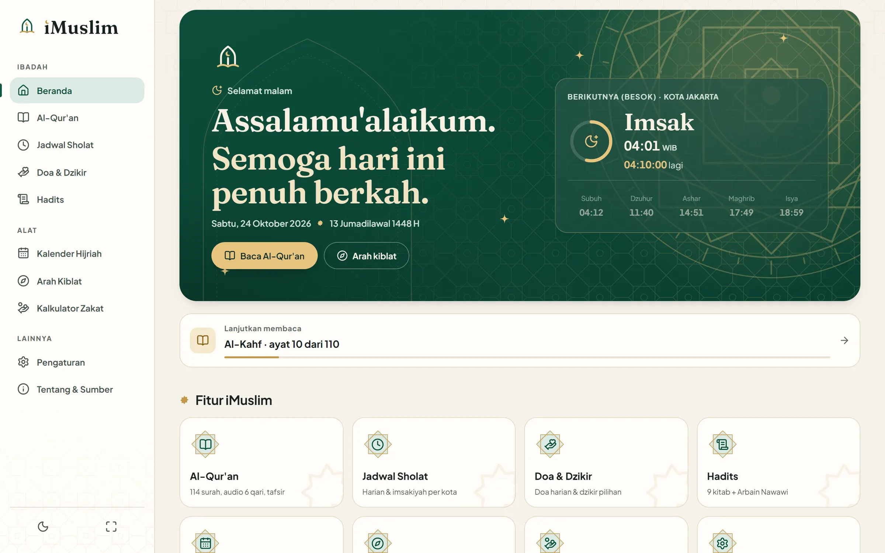

</div>

---

## Daftar isi

- [Sekilas](#sekilas)
- [Galeri](#galeri)
- [Fitur](#fitur)
- [Mulai cepat](#mulai-cepat)
- [Perintah yang tersedia](#perintah-yang-tersedia)
- [Arsitektur](#arsitektur)
- [Sumber data & API](#sumber-data--api)
- [Desain & identitas](#desain--identitas)
- [Aksesibilitas, performa, dan kualitas](#aksesibilitas-performa-dan-kualitas)
- [Deploy ke GitHub Pages](#deploy-ke-github-pages)
- [Privasi](#privasi)
- [Migrasi dari versi lama](#migrasi-dari-versi-lama)
- [Batasan yang diketahui](#batasan-yang-diketahui)
- [Kontribusi & kredit](#kontribusi--kredit)

## Sekilas

iMuslim adalah aplikasi web (PWA) untuk ibadah harian dalam Bahasa Indonesia. Versi 2 dibangun ulang dari situs HTML/jQuery/Vue lama menjadi **React + Vite**, dengan tiga prinsip:

1. **Konten agama tidak pernah dikarang.** Ayat, terjemahan, hadits, doa, dan waktu sholat selalu berasal dari API yang disebutkan sumbernya. Bila sumber gagal, iMuslim menampilkan error yang jelas atau data yang pernah dimuat dengan label *"mungkin usang"* — bukan tebakan.
2. **Pengguna yang memegang kendali.** Tidak ada audio otomatis, izin lokasi/notifikasi hanya diminta setelah tombol ditekan, dan semua data pribadi tinggal di perangkat.
3. **Terasa dirancang manusia.** Palet hijau zamrud & ivory, tipografi yang tenang, logo baru, mode gelap yang awalnya mengikuti perangkat, dan animasi yang hanya ada bila berguna.

## Galeri

<table>
  <tr>
    <td width="50%">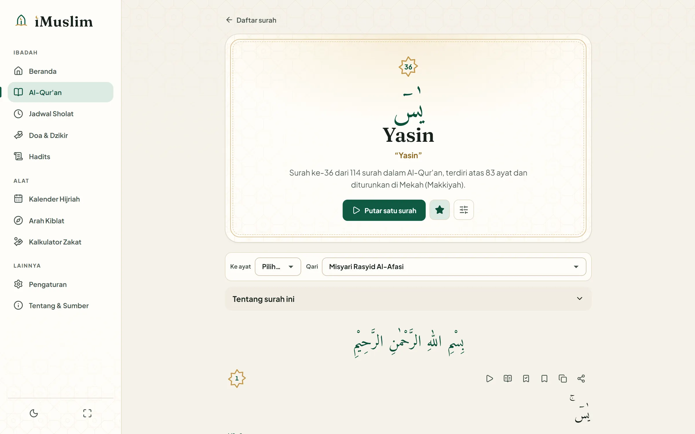</td>
    <td width="50%">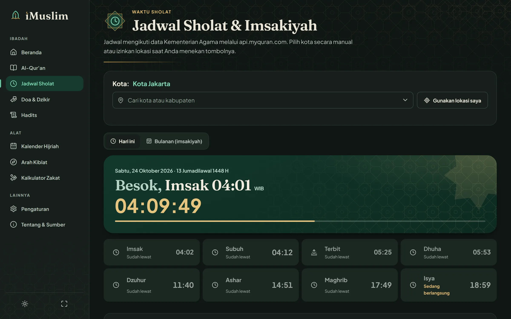</td>
  </tr>
  <tr>
    <td>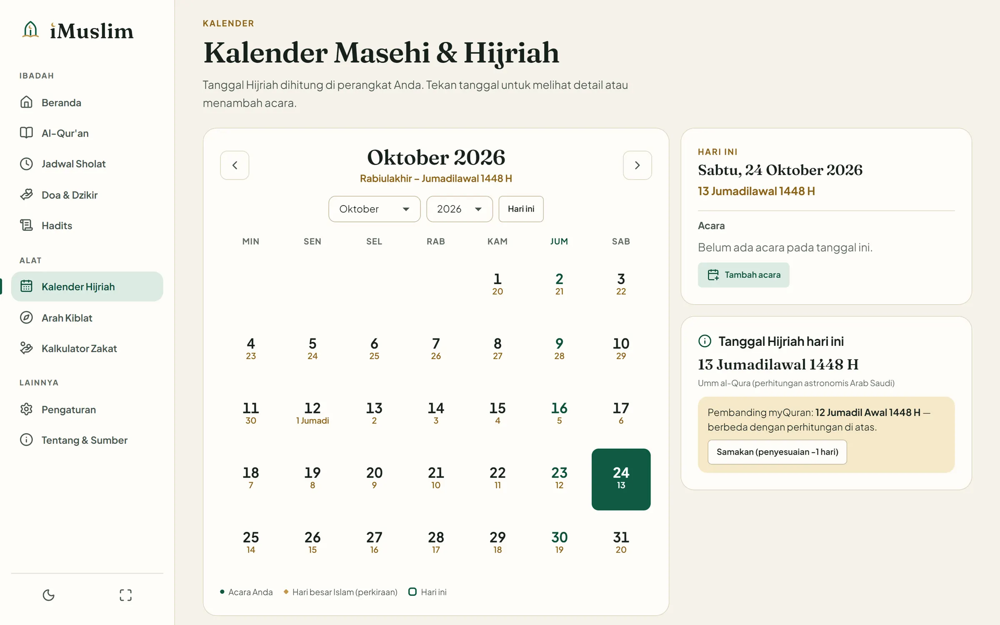</td>
    <td>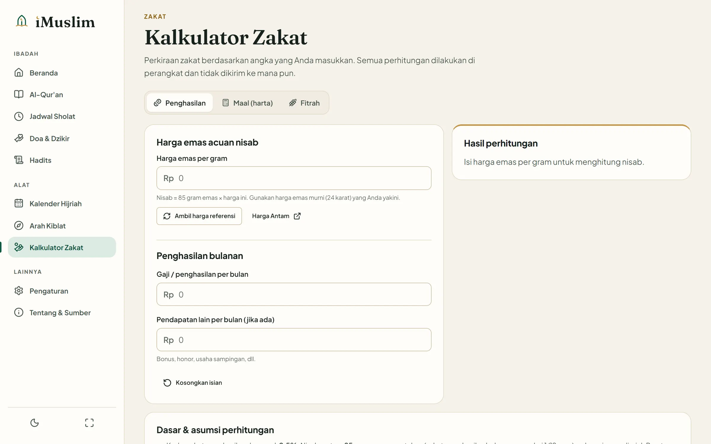</td>
  </tr>
  <tr>
    <td>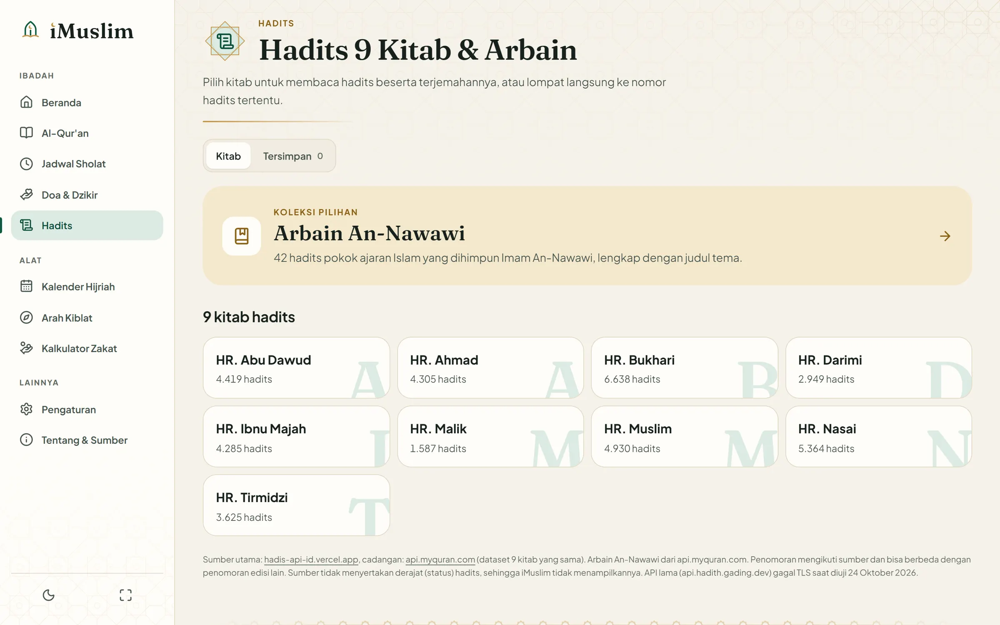</td>
    <td>
      <table>
        <tr>
          <td>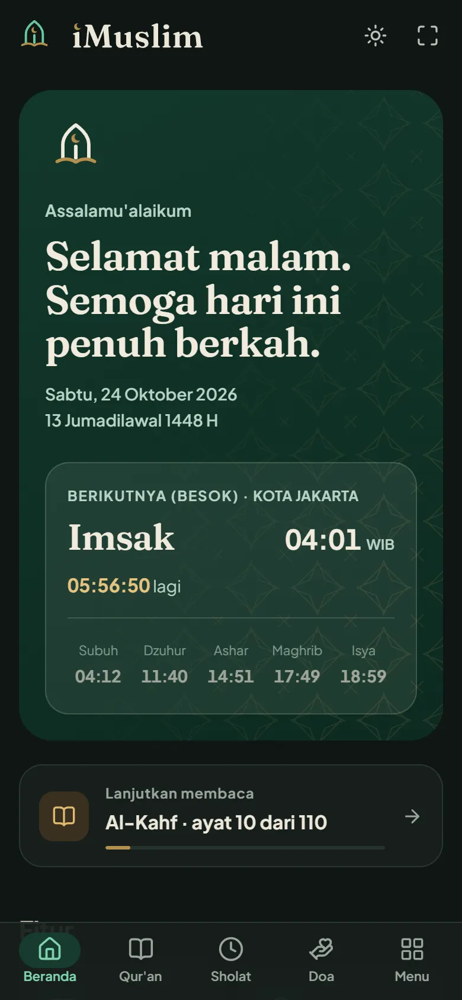</td>
          <td>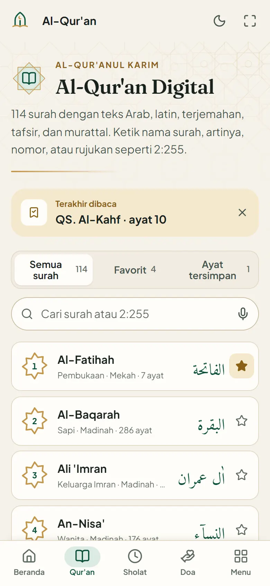</td>
          <td>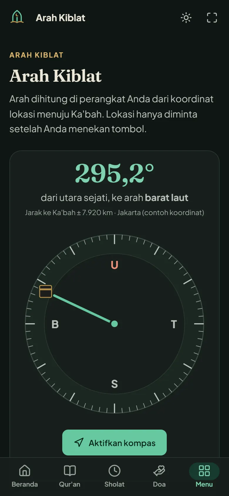</td>
        </tr>
      </table>
    </td>
  </tr>
</table>

<details>
<summary><b>Tangkapan layar ponsel lainnya</b></summary>
<br />
<p align="center">
  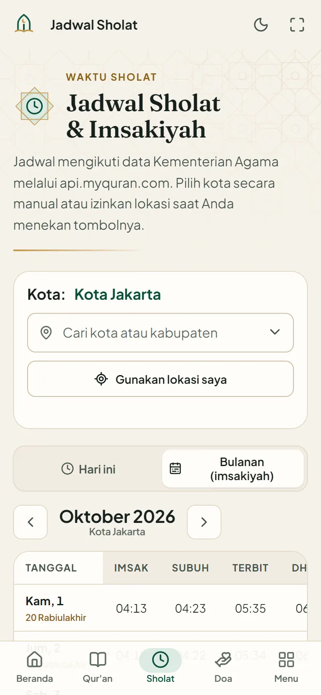
  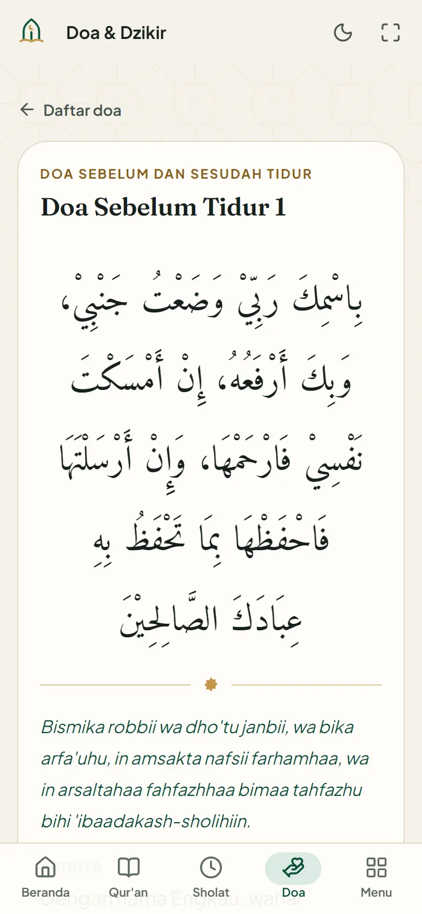
  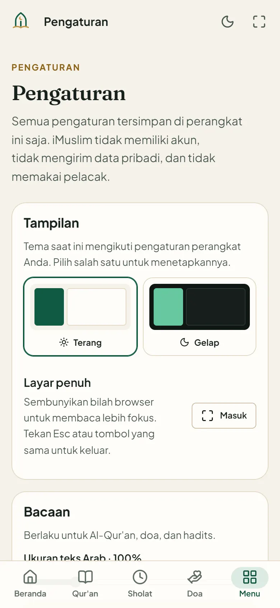
</p>
</details>

<sub>Tangkapan layar diambil dari build lokal dengan `node scripts/screenshots.mjs`. Kota, favorit, dan lokasi kiblat diisi contoh di penyimpanan lokal; jadwal, ayat, doa, dan hadits dimuat langsung dari API.</sub>

## Fitur

| Modul | Yang bisa dilakukan |
|---|---|
| **Beranda** | Sapaan sesuai waktu, tanggal Masehi + Hijriah, kartu waktu sholat berikutnya dengan hitung mundur, *lanjutkan membaca*, acara hari ini, ayat & hadits hari ini (dari API), rekomendasi kajian |
| **Al-Qur'an** | 114 surah, cari nama/arti/nomor/teks Arab, pencarian suara, pintasan `2:255`, favorit, paginasi · teks Arab, latin, terjemahan Kemenag, tafsir per ayat · murattal satu surah atau per ayat (berlanjut otomatis) dengan 6 qari · tandai terakhir dibaca, simpan ayat, salin, bagikan · ukuran huruf Arab |
| **Jadwal sholat** | 500+ kota/kabupaten, pencarian kota, *Gunakan lokasi saya* (opsional), jadwal hari ini dengan status & hitung mundur, tabel imsakiyah bulanan dengan kolom Hijriah, zona WIB/WITA/WIT, pengingat adzan & notifikasi opsional |
| **Doa & dzikir** | Dua koleksi: 227 doa equran.id (dengan latin & dalil) dan 108 doa myQuran · cari, filter kategori, paginasi, simpan, salin, bagikan |
| **Hadits** | 9 kitab (Bukhari, Muslim, Abu Dawud, Tirmidzi, Nasai, Ibnu Majah, Ahmad, Malik, Darimi) + Arbain An-Nawawi · paginasi, lompat ke nomor, simpan, salin, bagikan |
| **Kalender** | Masehi & Hijriah berdampingan, navigasi bulan/tahun & keyboard, hari besar Islam (perkiraan), acara pribadi (tambah/ubah/hapus/bagikan), pembanding tanggal myQuran |
| **Kiblat** | Arah & jarak ke Ka'bah dihitung lokal, dari GPS, nama tempat, atau koordinat manual · kompas perangkat (termasuk izin iOS) dengan deteksi sensor yang jujur |
| **Zakat** | Penghasilan, maal (dengan haul & utang), fitrah · harga emas referensi bertanggal atau isi manual · rumus & asumsi ditampilkan |
| **Pengaturan** | Tema terang/gelap (awalnya mengikuti perangkat), layar penuh, ukuran teks Arab, latin/terjemahan, qari, kota, pengingat, penyesuaian Hijriah, nama sapaan, pasang aplikasi, ekspor/impor/hapus data lokal |
| **Umum** | Navigasi bawah di ponsel, rail/sidebar di tablet & desktop, tombol layar penuh, PWA dapat dipasang, mode offline untuk data yang pernah dimuat, pemutar audio tunggal (tidak pernah bertumpuk) dengan kontrol layar kunci |

## Mulai cepat

Prasyarat: **Node.js ≥ 20.19** (diuji dengan 22.19) dan npm.

```bash
git clone https://github.com/SyamayDev/muslimweb.git
cd muslimweb
npm install
npm run dev          # http://localhost:5173/muslimweb/
```

Aplikasi selalu berjalan di bawah base path `/muslimweb/` — sama seperti di GitHub Pages — sehingga tidak ada kejutan saat deploy.

## Perintah yang tersedia

| Perintah | Fungsi |
|---|---|
| `npm run dev` | Server pengembangan Vite |
| `npm run build` | Build produksi ke `dist/` lalu `scripts/postbuild.mjs` (HTML per route, 404.html, sitemap, preload) |
| `npm run preview` | Melayani `dist/` **persis seperti GitHub Pages** (tanpa rewrite SPA) di `http://localhost:4173/muslimweb/` |
| `npm run lint` | ESLint (termasuk aturan React Hooks/React Compiler) |
| `npm test` | Vitest + Testing Library: utilitas, pemetaan API (dengan respons asli), migrasi, komponen, kontras warna |
| `npm run test:e2e` | Playwright terhadap `dist/` di desktop & ponsel (butuh `npm run build` dan Google Chrome; atau `PW_CHANNEL=bundled` setelah `npx playwright install chromium`) |
| `npm run lighthouse` | Lighthouse mobile & desktop untuk route utama → `reports/lighthouse/` (butuh Chrome; set `CHROME_PATH` bila perlu) |
| `npm run brand` | Membuat ulang logo, favicon, ikon PWA, dan gambar OG dari `scripts/brand-geometry.mjs` |
| `node scripts/screenshots.mjs` | Membuat ulang tangkapan layar README di `docs/screenshots/` |
| `node scripts/fetch-static-data.mjs` | Mengambil ulang indeks 114 surah dari equran.id (tervalidasi total 6.236 ayat) |

> Di Git Bash (Windows), awali perintah yang menerima path route dengan `MSYS_NO_PATHCONV=1`, misalnya `MSYS_NO_PATHCONV=1 npm run lighthouse -- /quran/`.

## Arsitektur

```text
src/
  app/          App (router), AppShell, audio tunggal, tema, store localStorage, migrasi data lama
  components/   brand (logo), layout (shell, navigasi, pemutar, pengingat), ui (dialog, status, toast, …)
  features/     komponen per domain: sholat (pemilih kota, jadwal), hadits, doa, quran, beranda
  pages/        satu file per route + CSS-nya (dimuat lazy per halaman)
  services/api/ client (timeout, retry, klasifikasi error), cache IndexedDB, layanan per sumber
  hooks/        useResource, useNow, useFullscreen, useShare, useSpeechSearch, …
  utils/        hijri, kiblat, zakat, waktu sholat, format, teks aman
  data/         indeks surah tervalidasi, daftar video terverifikasi
public/         brand/, icons/, audio/ (adzan), manifest.webmanifest, sw.js
scripts/        build & tooling (postbuild, brand, lighthouse, screenshots, server lokal)
e2e/            tes Playwright
legacy/         arsip situs lama (tidak di-deploy)
docs/           AUDIT.md, tangkapan layar
```

### Routing di GitHub Pages

iMuslim memakai **URL bersih** (`/muslimweb/quran/36`) dengan `BrowserRouter`, bukan hash. GitHub Pages tidak punya rewrite SPA, jadi `scripts/postbuild.mjs`:

1. menyalin `index.html` ke setiap route statis (`/quran/`, `/sholat/`, …) **dan** ke 114 halaman surah, 42 Arbain, 335 detail doa, serta 10 kitab hadits — semuanya terbuka langsung & bisa di-refresh dengan **HTTP 200**, lengkap dengan `<title>`, deskripsi, dan canonical masing-masing;
2. menyalin aplikasi ke `404.html` untuk route dinamis lain (mis. `/hadits/bukhari/52`) — tetap tampil benar di browser;
3. membuat halaman untuk alamat lama (`/jadwalsholatdanimsakiah/`, `/hadist/`, `/kalkulatorzakat/`, `/setting/`, `…/index.html`) yang dialihkan ke route baru;
4. menyisipkan `modulepreload`/stylesheet halaman dan preload font per route agar tidak ada rantai muat bertingkat;
5. membuat `sitemap.xml`, `robots.txt`, `.nojekyll`, dan memberi versi pada service worker.

### Lapisan data

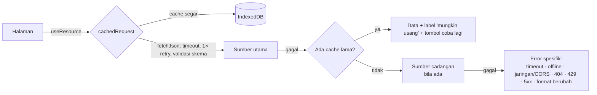

- Setiap respons divalidasi lalu dipetakan ke model internal; bila bentuknya berubah, data **ditolak** (tidak ditampilkan setengah benar).
- Permintaan identik yang bersamaan dideduplikasi; permintaan banyak (cadangan hadits) dibatasi 4 sekaligus.
- Tidak ada `dangerouslySetInnerHTML`: deskripsi surah ber-HTML diurai menjadi teks aman.
- Service worker hanya meng-cache *app shell* & aset ber-hash. Data API **tidak** di-cache oleh service worker agar data lama selalu diberi label.

## Sumber data & API

Semua endpoint diuji pada **24 Oktober 2026** (status HTTP, CORS, bentuk JSON, error). Bukti lengkap ada di [`docs/AUDIT.md`](docs/AUDIT.md).

| Data | Sumber utama | Cadangan |
|---|---|---|
| Al-Qur'an, tafsir, audio 6 qari | [equran.id](https://equran.id) API v2 | api.alquran.cloud (dipetakan per nomor ayat) |
| Ayat hari ini | [api.alquran.cloud](https://alquran.cloud/api) | equran.id |
| Jadwal sholat & kota | [api.myquran.com](https://api.myquran.com) v2 | cache yang pernah dimuat |
| Doa & dzikir (227) | [equran.id/api/doa](https://equran.id/api/doa) | cache |
| Kumpulan doa (108) | api.myquran.com/v2/doa | cache |
| Hadits 9 kitab | [hadis-api-id.vercel.app](https://hadis-api-id.vercel.app/hadith) | api.myquran.com/v2/hadits |
| Arbain An-Nawawi | api.myquran.com/v2/hadits/arbain | cache |
| Harga emas referensi | [fawazahmed0/exchange-api](https://github.com/fawazahmed0/exchange-api) | mirror pages.dev |
| Nama lokasi | [Nominatim / OpenStreetMap](https://nominatim.org) | pilih kota / isi koordinat |

> API hadits lama `api.hadith.gading.dev` gagal *TLS handshake* secara konsisten (5 percobaan, dua tumpukan TLS berbeda) — bukan sekadar timeout — sehingga diganti penyedia aktif dengan dataset 9 kitab yang sama.

**Dihitung lokal (tanpa jaringan):** arah & jarak kiblat (rumus lingkaran besar), tanggal Hijriah (kalender Umm al-Qura bawaan browser + cadangan tabular), rumus zakat.

## Desain & identitas

<p align="center">
  
  &nbsp;&nbsp;
  
</p>

- **Logo** dibuat dari nol: lengkung **mihrab** sebagai ruang ibadah, **bulan sabit** yang sekaligus menjadi titik huruf *i*, dan **buku terbuka** sebagai ilmu. Tersedia mark, wordmark (Fraunces dikonversi menjadi path), logo horizontal untuk latar terang & gelap, favicon, ikon PWA biasa & *maskable*, dan gambar Open Graph — semua dihasilkan dari satu sumber geometri (`npm run brand`).
- **Palet:** hijau zamrud `#0F5A44`, ivory `#F6F2E9`, aksen emas secukupnya, teks hampir hitam kehijauan; mode gelap dengan token sendiri. Semua pasangan teks/latar diuji otomatis **≥ 4,5 : 1** (WCAG AA).
- **Tipografi:** Plus Jakarta Sans (UI, karya foundry Indonesia Tokotype), Fraunces (judul), Amiri Quran (teks Arab) — di-host sendiri, hanya subset yang dibutuhkan.
- **Ikon:** Lucide, satu sistem ukuran; tanpa emoji sebagai ikon.
- **Gerak:** masuk halaman & daftar bertahap, logo yang "tergambar" di beranda, indikator audio, lembar bawah, kompas yang berputar — singkat dan dimatikan otomatis bila `prefers-reduced-motion`.

## Aksesibilitas, performa, dan kualitas

**Aksesibilitas:** `lang="id"`, teks Arab dengan `lang="ar" dir="rtl"`, tautan *lewati ke konten*, satu `h1` per halaman, fokus terlihat, dialog `<dialog>` native dengan fokus terkelola, combobox kota yang dapat dioperasikan keyboard, grid kalender dengan tombol panah, status error diumumkan (`role="alert"`/`aria-live`), zoom tidak dikunci, status tidak hanya bergantung warna.

**Tes otomatis**

| Jenis | Jumlah | Cakupan |
|---|---|---|
| Unit & komponen (Vitest) | 143 tes / 10 file | kiblat, Hijriah (dibandingkan dengan ICU), waktu sholat & zona, zakat, teks aman, pencocokan kota, client API (timeout/404/429/5xx/CORS/retry/dedupe/cache usang/cadangan), pemetaan respons asli 14 endpoint, migrasi data lama, validasi storage rusak, fullscreen, tema, paginasi, kontras warna |
| End-to-end (Playwright) | 78 tes (desktop + ponsel) | semua route dibuka langsung & di-refresh, alamat lama, 404, navigasi, tanpa scroll horizontal di 320–1440 px, tombol tema (ikut perangkat → terang ↔ gelap) & tema bertahan, layar penuh, aksesibilitas dasar, alur Al-Qur'an/audio/jadwal/izin lokasi ditolak/doa/hadits/kalender/kiblat/zakat terhadap API sungguhan |

**Lighthouse** — diukur 24 Oktober 2026 dengan Lighthouse 13.5.0 (Chrome 156, throttling simulasi bawaan) terhadap build produksi yang dilayani seperti GitHub Pages (`npm run lighthouse`). Skor nyata bisa berbeda tergantung jaringan, perangkat, dan respons API pihak ketiga.

| Route | Desktop P · A · BP · SEO | Mobile P · A · BP · SEO | LCP mobile |
|---|---|---|---|
| `/` | **100 · 100 · 100 · 100** | 85 · 100 · 100 · 100 | 4,0 s |
| `/quran/` | **100 · 100 · 100 · 100** | 96 · 100 · 100 · 100 | 2,4 s |
| `/quran/1/` | **100 · 100 · 100 · 100** | 85 · 100 · 100 · 100 | 4,1 s |
| `/sholat/` | **100 · 100 · 100 · 100** | 90 · 100 · 100 · 100 | 3,4 s |
| `/doa/` | **100 · 100 · 100 · 100** | 82 · 100 · 100 · 100 | 4,7 s |
| `/hadits/` | **100 · 100 · 100 · 100** | 96 · 100 · 100 · 100 | 2,4 s |
| `/kalender/` | **100 · 100 · 100 · 100** | 90 · 100 · 100 · 100 | 3,4 s |
| `/kiblat/` | **100 · 100 · 100 · 100** | 96 · 100 · 100 · 100 | 2,4 s |
| `/zakat/` | **100 · 100 · 100 · 100** | 97 · 100 · 100 · 100 | 2,3 s |

CLS = 0 dan TBT = 0 ms di semua route. Sisa selisih Performance mobile berasal dari waktu eksekusi React di CPU yang disimulasikan 4× lebih lambat dan, pada halaman yang LCP-nya berupa konten API (daftar doa, ayat), dari latensi API.

## Deploy ke GitHub Pages

1. Di repositori: **Settings → Pages → Build and deployment → Source: GitHub Actions** (sekali saja; sebelumnya situs dilayani langsung dari branch).
2. Push ke `main`. Workflow [`.github/workflows/deploy.yml`](.github/workflows/deploy.yml) menjalankan lint → tes → build → deploy `dist/`.
3. Situs tersedia di <https://syamaydev.github.io/muslimweb/>.

Base path diatur di [`vite.config.js`](vite.config.js) (`base: '/muslimweb/'`). Bila repositori diganti nama, ubah nilai itu, `SITE`/`BASE_PATH` di `scripts/postbuild.mjs`, dan `SITE_URL` di `src/app/site.js`.

## Privasi

- Tidak ada akun, iklan, analitik, atau cookie pelacak.
- Bookmark, pengaturan, kota, dan acara disimpan di `localStorage`; respons API di IndexedDB. Semuanya bisa diekspor, diimpor, atau dihapus dari **Pengaturan**.
- Lokasi hanya diminta saat tombol ditekan. Untuk jadwal sholat, koordinat dikirim ke Nominatim hanya untuk mengetahui nama kota dan tidak disimpan; untuk kiblat, koordinat disimpan di perangkat agar tidak perlu diminta ulang.

## Migrasi dari versi lama

Situs lama (Bootstrap + jQuery + Vue) diarsipkan utuh di [`legacy/`](legacy) dan tidak di-deploy. Ringkasan perbaikan penting:

- Halaman doa lama kosong karena skema API berubah; latin doa sebelumnya dikarang dengan transliterasi huruf naif.
- API hadits lama tidak dapat diakses (gagal TLS).
- Harga emas zakat berupa angka tetap yang tampak seperti data nyata; Hijriah memakai satu tanggal acuan; tanggal acara tersimpan mundur 1 hari di WIB.
- Nomor telepon pribadi di menu, kata sandi teks polos di `localStorage`, tautan `example.com`/template, `YOUR_API_KEY`, metadata template "Nepro", dan branding lama dihapus.
- Data pengguna lama (tema, favorit surah, terakhir dibaca, doa & hadits tersimpan, acara kalender) **dimigrasikan otomatis** ke format baru.

Detail lengkap: [`docs/AUDIT.md`](docs/AUDIT.md).

## Batasan yang diketahui

- Pengingat adzan & notifikasi hanya berjalan selama iMuslim terbuka (belum ada server push).
- Tanggal Hijriah adalah hasil perhitungan; penetapan resmi Indonesia (sidang isbat) bisa berbeda ±1 hari — gunakan penyesuaian di Pengaturan.
- Kompas memerlukan magnetometer; di laptop/desktop gunakan sudut kiblat dengan kompas fisik.
- Konten bergantung pada API pihak ketiga. Bila sumber berubah atau mati, iMuslim menampilkan error/penanda usang, bukan data pengganti.
- Detail hadits per nomor yang dibuka langsung dilayani via `404.html` (berfungsi di browser, tetapi berstatus 404 bagi crawler).
- Skor Performance mobile dibatasi waktu eksekusi React di CPU yang disimulasikan lambat; menaikkannya lagi memerlukan prerender/SSR.

## Kontribusi & kredit

Temukan masalah atau data yang keliru? Buka [issue](https://github.com/SyamayDev/muslimweb/issues) dengan menyebutkan halaman dan sumber datanya.

- Data: equran.id, api.myquran.com, api.alquran.cloud & cdn.islamic.network, hadis-api-id, fawazahmed0/exchange-api, © OpenStreetMap contributors (ODbL).
- Huruf: Plus Jakarta Sans, Fraunces, Amiri Quran (SIL Open Font License) via Fontsource. Ikon: Lucide (ISC).
- Audio adzan berasal dari iMuslim versi sebelumnya.

Lisensi kode belum ditetapkan oleh pemilik repositori.

<p align="center"><sub>Dikembangkan oleh <a href="https://github.com/SyamayDev">SyamayDev</a> · Semoga bermanfaat.</sub></p>
