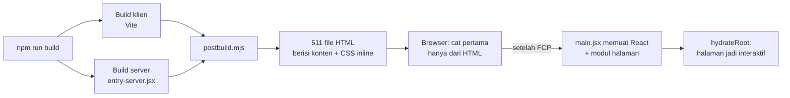
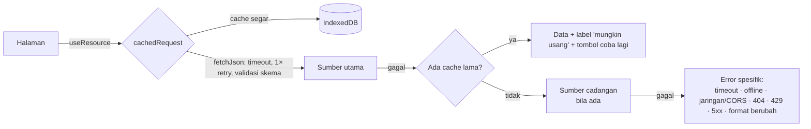
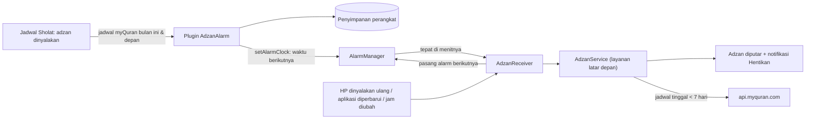
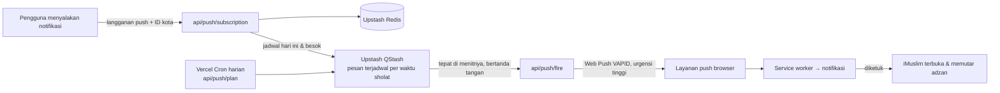

<div align="center">

<a href="https://syamaydev.github.io/imuslim/">
  <picture>
    <source media="(prefers-color-scheme: dark)" srcset="public/brand/imuslim-logo-on-dark.svg" />
    
  </picture>
</a>

### Teman ibadah harian yang tenang, cepat, dan jujur soal datanya.

Al-Qur'an dengan audio & tafsir · Jadwal sholat & imsakiyah · Doa & dzikir · Hadits 9 kitab · Kalender Hijriah · Arah kiblat · Kalkulator zakat

<p>
  <a href="https://syamaydev.github.io/imuslim/"></a>
</p>
<p>
  
  
  
  
  
  
</p>


</div>

---

## Daftar isi

- [Sekilas](#sekilas)
- [Galeri](#galeri)
- [Fitur](#fitur)
- [Mulai cepat](#mulai-cepat)
- [Perintah yang tersedia](#perintah-yang-tersedia)
- [Deploy: GitHub Pages & Vercel](#deploy-github-pages--vercel)
- [Arsitektur](#arsitektur)
- [Sumber data & API](#sumber-data--api)
- [Desain, corak & animasi](#desain-corak--animasi)
- [Aplikasi Android (APK)](#aplikasi-android-apk)
- [Notifikasi saat iMuslim ditutup (Web Push)](#notifikasi-saat-imuslim-ditutup-web-push)
- [Kualitas: aksesibilitas, tes, Lighthouse](#kualitas-aksesibilitas-tes-lighthouse)
- [Film motion graphic](#film-motion-graphic)
- [Privasi](#privasi)
- [Migrasi dari versi lama](#migrasi-dari-versi-lama)
- [Batasan yang diketahui](#batasan-yang-diketahui)
- [Kontribusi & kredit](#kontribusi--kredit)

## Sekilas

iMuslim adalah aplikasi web (PWA) untuk ibadah harian dalam Bahasa Indonesia, dibangun ulang dari situs HTML/jQuery/Vue lama menjadi **React + Vite**. Tiga prinsipnya:

1. **Konten agama tidak pernah dikarang.** Ayat, terjemahan, hadits, doa, dan waktu sholat selalu berasal dari API yang disebutkan sumbernya. Bila sumber gagal, iMuslim menampilkan error yang jelas atau data yang pernah dimuat dengan label *"mungkin usang"*, bukan tebakan.
2. **Pengguna yang memegang kendali.** Tidak ada audio otomatis. Izin lokasi dan notifikasi hanya diminta setelah tombol ditekan, dan semua data pribadi tinggal di perangkat.
3. **Cepat di ponsel apa pun.** Setiap halaman **diprerender menjadi HTML utuh** saat build, jadi konten langsung tampil sebelum JavaScript selesai dimuat. Setelah itu React mengambil alih (*hydration*).

## Galeri

<table>
  <tr>
    <td width="50%"></td>
    <td width="50%"></td>
  </tr>
  <tr>
    <td></td>
    <td></td>
  </tr>
  <tr>
    <td></td>
    <td>
      <table>
        <tr>
          <td></td>
          <td></td>
          <td></td>
        </tr>
      </table>
    </td>
  </tr>
</table>

<details>
<summary><b>Tangkapan layar ponsel lainnya</b></summary>
<br />
<p align="center">
  
  
  
</p>
</details>

<sub>Tangkapan layar diambil dari build lokal dengan `node scripts/screenshots.mjs`. Kota, favorit, dan lokasi kiblat diisi contoh di penyimpanan lokal; jadwal, ayat, doa, dan hadits dimuat langsung dari API.</sub>

## Fitur

| Modul | Yang bisa dilakukan |
|---|---|
| **Beranda** | Sapaan sesuai waktu, tanggal Masehi + Hijriah, kartu waktu sholat berikutnya dengan cincin progres & hitung mundur, *lanjutkan membaca*, acara hari ini, ayat & hadits hari ini (dari API), rekomendasi kajian |
| **Al-Qur'an** | 114 surah, cari nama/arti/nomor/teks Arab, pencarian suara, pintasan `2:255`, favorit, paginasi · kepala surah bergaya mushaf · teks Arab, latin, terjemahan Kemenag, tafsir per ayat · murattal satu surah atau per ayat (berlanjut otomatis) dengan 6 qari · tandai terakhir dibaca, simpan ayat, salin, bagikan · ukuran huruf Arab · surah panjang dirender bertahap agar tetap ringan |
| **Jadwal sholat** | 517 dari 518 kota/kabupaten (satu kota tidak punya data di sumber), pencarian kota, *Gunakan lokasi saya* (opsional), jadwal hari ini dengan status & hitung mundur, tabel imsakiyah bulanan dengan kolom Hijriah, zona WIB/WITA/WIT, adzan tepat waktu saat iMuslim terbuka · **aplikasi Android: adzan berbunyi sendiri walau aplikasi ditutup** · versi web: notifikasi tepat waktu walau ditutup (Web Push; ketuk untuk memutar adzan) |
| **Doa & dzikir** | Dua koleksi: 227 doa equran.id (dengan latin & dalil) dan 108 doa myQuran · cari, filter kategori, paginasi, simpan, salin, bagikan |
| **Hadits** | 9 kitab (Bukhari, Muslim, Abu Dawud, Tirmidzi, Nasai, Ibnu Majah, Ahmad, Malik, Darimi) + Arbain An-Nawawi · paginasi, lompat ke nomor, simpan, salin, bagikan |
| **Kalender** | Masehi & Hijriah berdampingan, navigasi bulan/tahun & keyboard, hari besar Islam (perkiraan), acara pribadi (tambah/ubah/hapus/bagikan), pembanding tanggal myQuran |
| **Kiblat** | Cukup satu tombol **"Gunakan lokasi saya"**: arah & jarak ke Ka'bah dihitung lokal di perangkat · bila izin lokasi ditolak, ketik nama kota (tanpa istilah lintang/bujur) · kompas perangkat (termasuk izin iOS) dengan deteksi sensor yang jujur |
| **Zakat** | Penghasilan, maal (dengan haul & utang), fitrah · harga emas referensi bertanggal atau isi manual · rumus & asumsi ditampilkan |
| **Pengaturan** | Tema terang/gelap (awalnya mengikuti perangkat), layar penuh, ukuran teks Arab, latin/terjemahan, qari, kota, pengingat, penyesuaian Hijriah, nama sapaan, unduh aplikasi Android (APK) atau pasang versi web (PWA), ekspor/impor/hapus data lokal |
| **Umum** | Navigasi bawah di ponsel, rail/sidebar di tablet & desktop, tombol layar penuh, PWA yang bisa dipasang, halaman yang pernah dibuka tetap tersedia offline, pemutar audio tunggal (tidak pernah bertumpuk) dengan kontrol layar kunci |

## Mulai cepat

Prasyarat: **Node.js ≥ 20.19** (diuji dengan 22.19) dan npm.

```bash
git clone https://github.com/SyamayDev/imuslim.git
cd imuslim
npm install
npm run dev          # http://localhost:5173/imuslim/
```

Mode dev merender di browser saja. Untuk melihat hasil persis seperti produksi (HTML prerender, CSS inline, service worker):

```bash
npm run build && npm run preview   # http://localhost:4173/imuslim/
```

## Perintah yang tersedia

| Perintah | Fungsi |
|---|---|
| `npm run dev` | Server pengembangan Vite |
| `npm run build` | Build klien + build server (`src/entry-server.jsx`) lalu `scripts/postbuild.mjs`: prerender 511 halaman, CSS inline, preload per route, 404.html, sitemap, robots, manifest |
| `npm run preview` | Melayani `dist/` **persis seperti GitHub Pages** (tanpa rewrite SPA) |
| `npm run deploy` | Build lalu publikasikan `dist/` ke branch `gh-pages` dari komputer Anda (alternatif manual dari workflow) |
| `npm run lint` | ESLint (termasuk aturan React Hooks / React Compiler) |
| `npm test` | Vitest + Testing Library: utilitas, pemetaan API (respons asli), migrasi, komponen, prerender/hydration, kontras warna |
| `npm run test:e2e` | Playwright terhadap `dist/` di desktop & ponsel (butuh `npm run build` dan Google Chrome, atau `PW_CHANNEL=bundled` setelah `npx playwright install chromium`) |
| `npm run lighthouse` | Lighthouse mobile & desktop untuk route utama → `reports/lighthouse/` (butuh Chrome; set `CHROME_PATH` bila perlu) |
| `npm run brand` | Membuat ulang logo, favicon, ikon PWA, dan gambar OG dari `scripts/brand-geometry.mjs` |
| `npm run android:build` | APK Android rilis bertanda tangan → `public/download/imuslim.apk` (lihat [Aplikasi Android](#aplikasi-android-apk)) |
| `npm run android:debug` | APK debug untuk pengujian (WebView bisa diperiksa lewat `chrome://inspect`) |
| `node scripts/screenshots.mjs` | Membuat ulang tangkapan layar README di `docs/screenshots/` |
| `node scripts/fetch-static-data.mjs` | Mengambil ulang indeks 114 surah dari equran.id (tervalidasi total 6.236 ayat) |

> Di Git Bash (Windows), awali perintah yang menerima path route dengan `MSYS_NO_PATHCONV=1`, misalnya `MSYS_NO_PATHCONV=1 npm run lighthouse -- /quran/`.

## Deploy: GitHub Pages & Vercel

Satu kode, dua tujuan. Base path diatur otomatis oleh [`scripts/site-config.mjs`](scripts/site-config.mjs):

| Tujuan | Base | URL kanonis | Cara terbit |
|---|---|---|---|
| **GitHub Pages** | `/imuslim/` | `https://syamaydev.github.io/imuslim/` | Push ke `main` → workflow [`deploy.yml`](.github/workflows/deploy.yml) menjalankan lint → tes → build → publikasi ke branch **`gh-pages`** |
| **Vercel** | `/` (terdeteksi dari `VERCEL=1`) | domain produksi Vercel (`VERCEL_PROJECT_PRODUCTION_URL`) | Vercel membangun sendiri dari `main` memakai [`vercel.json`](vercel.json) |

`BASE_PATH` dan `SITE_URL` bisa menimpa keduanya, misalnya untuk domain kustom.

### Pengaturan sekali saja

**GitHub Pages**

1. Push ke `main` sekali, lalu tunggu workflow **Deploy GitHub Pages** selesai. Workflow ini membuat branch `gh-pages`.
2. Buka **Settings → Pages → Build and deployment**, pilih **Source: Deploy from a branch**, **Branch: `gh-pages`**, folder **`/ (root)`**, lalu simpan.
3. Selesai. Setiap push ke `main` akan otomatis memperbarui <https://syamaydev.github.io/imuslim/>.

> Jangan pilih branch `main`. Branch itu berisi kode sumber, dan GitHub Pages akan menayangkannya mentah-mentah sehingga hasilnya halaman kosong dengan logo rusak.

**Vercel**

1. Di [vercel.com/new](https://vercel.com/new), impor repositori `SyamayDev/imuslim`. Framework, perintah build, dan folder output terbaca otomatis dari `vercel.json`.
2. Selesai. Setiap push ke `main` membuat deploy produksi baru. Branch `gh-pages` sengaja tidak di-deploy oleh Vercel.

`vercel.json` juga mengatur cache aset satu tahun, header keamanan (`nosniff`, HSTS, `Referrer-Policy`, `X-Frame-Options`), dan `Permissions-Policy` yang tetap mengizinkan lokasi, kompas, dan mikrofon untuk situs ini sendiri. Selain itu, rewrite membuat detail hadits/doa yang tidak diprerender berstatus 200.

## Arsitektur

```text
src/
  main.jsx         entry super kecil (≈3 KB gzip): CSS, migrasi data lama, lalu memuat React setelah cat pertama
  boot.jsx         hydrateRoot (halaman prerender) atau createRoot (404, alamat lama, mode dev)
  entry-server.jsx prerender React 19 (prerenderToNodeStream + StaticRouter), dipakai saat build
  app/             App & rute, daftar halaman (lazy + preload/prefetch), audio tunggal, tema, store localStorage
  components/      brand (logo + sprite SVG), layout (shell, navigasi, pemutar, pengingat), ui (dialog, status, ornamen…)
  features/        komponen per domain: sholat, hadits, doa, quran, beranda
  pages/           satu file per route + CSS-nya
  services/api/    client (timeout, retry, klasifikasi error), cache IndexedDB, layanan per sumber
  hooks/           useResource, useNow, useHydrated/useClientValue, useFullscreen, useShare, useSpeechSearch…
  utils/           hijri, kiblat, zakat, waktu sholat, format, teks aman, validator
  styles/          token warna, dasar, komponen, tata letak, ornamen & animasi
public/            brand/, icons/, audio/ (adzan), manifest.webmanifest, sw.js (cache + push)
api/               Vercel Functions: notifikasi push (config, subscription, test, fire, plan)
scripts/           site-config, postbuild (prerender), serve-dist, lighthouse, screenshots, brand, gh-pages-prepare
e2e/               tes Playwright
legacy/            arsip situs lama (tidak di-deploy)
docs/              AUDIT.md, tangkapan layar, MASTERPROMPT-MOTION.md (prompt film motion graphic)
motion/            proyek film motion graphic (Remotion) — terpisah dari aplikasi
```

### Bagaimana halaman bisa secepat ini



1. **Prerender + data.** Setiap route statis (10 halaman utama, 114 surah, 9 kitab hadits, 42 Arbain, 335 detail doa) dirender React di Node menjadi HTML lengkap. Hasilnya bisa dibuka atau di-refresh langsung dengan status **HTTP 200**, dan masing-masing punya `<title>`, deskripsi, canonical, serta Open Graph sendiri.
   Isi **227 + 108 doa dan 42 hadits Arbain** juga diambil dari API saat build (pemeta & validasi yang sama dengan aplikasi) lalu ditanam di halamannya, sehingga teks doa/hadits tampil tanpa menunggu API dan bisa dirayapi mesin pencari. Di browser, data tetap diperiksa ulang ke sumber; bila sumber gagal, teks ditandai *"mungkin usang"*.
2. **Tanpa permintaan yang menghalangi cat pertama.** Seluruh CSS (±17 KB gzip) di-inline. Font di-preload (font Arab hanya di halaman yang memuat teks Arab). Skrip satu-satunya diberi `fetchpriority="low"`.
3. **JavaScript setelah cat pertama.** `main.jsx` menunggu *First Contentful Paint*, baru memuat React dan modul halaman. Hydration berjalan di dalam `startTransition` sehingga thread utama tidak terkunci.
4. **Hydration yang aman.** Nilai yang hanya diketahui di perangkat pengguna (isi `localStorage`, jam, dukungan API browser) memakai `useSyncExternalStore` dengan nilai bawaan saat prerender. Hasilnya, HTML statis dan render pertama di browser identik (tanpa *hydration mismatch*), lalu React langsung memperbaruinya dengan nilai sebenarnya. Kerangka (*skeleton*) punya ukuran yang sama dengan konten akhir sehingga tidak ada pergeseran tata letak.
5. **Navigasi instan.** Modul halaman tujuan di-prefetch saat tautan disentuh, diarahkan kursor, atau difokus. Transisi halaman hanya diputar saat berpindah di dalam aplikasi.
6. **Fallback.** Alamat lain (mis. `/hadits/bukhari/52`) dilayani `404.html`, lalu aplikasi merender halaman yang tepat di browser. Alamat lama (`/jadwalsholatdanimsakiah/`, `/hadist/`, `/kalkulatorzakat/`, `/setting/`, `…/index.html`) dialihkan ke route baru.

### Lapisan data



- Setiap respons divalidasi lalu dipetakan ke model internal. Bila bentuknya berubah, data **ditolak** (tidak ditampilkan setengah benar).
- Permintaan identik yang bersamaan dideduplikasi. Permintaan banyak (cadangan hadits) dibatasi 4 sekaligus.
- Tidak ada `dangerouslySetInnerHTML`: deskripsi surah ber-HTML diurai menjadi teks aman.
- Service worker menyimpan aset ber-hash dan HTML halaman yang pernah dibuka (maks. 40) untuk offline. Data API **tidak** di-cache oleh service worker, supaya data lama selalu diberi label.

## Sumber data & API

Semua endpoint diuji pada **24 Oktober 2026** (status HTTP, CORS, bentuk JSON, error). Jadwal Oktober 2026 untuk **seluruh 518 kota** diperiksa satu per satu. Bukti lengkap ada di [`docs/AUDIT.md`](docs/AUDIT.md).

| Data | Sumber utama | Cadangan |
|---|---|---|
| Al-Qur'an, tafsir, audio 6 qari | [equran.id](https://equran.id) API v2 | api.alquran.cloud (dipetakan per nomor ayat) |
| Ayat hari ini | [api.alquran.cloud](https://alquran.cloud/api) | equran.id |
| Jadwal sholat & kota | [api.myquran.com](https://api.myquran.com) v2 | cache yang pernah dimuat |
| Doa & dzikir (227) | [equran.id/api/doa](https://equran.id/api/doa) | cache |
| Kumpulan doa (108) | api.myquran.com/v2/doa | cache |
| Hadits 9 kitab | [hadis-api-id.vercel.app](https://hadis-api-id.vercel.app/hadith) | api.myquran.com/v2/hadits |
| Arbain An-Nawawi | api.myquran.com/v2/hadits/arbain | cache |
| Harga emas referensi | [fawazahmed0/exchange-api](https://github.com/fawazahmed0/exchange-api) | mirror pages.dev |
| Nama lokasi | [Nominatim / OpenStreetMap](https://nominatim.org) | pilih kota / isi koordinat |

> API hadits lama `api.hadith.gading.dev` gagal *TLS handshake* secara konsisten (5 percobaan, dua tumpukan TLS berbeda), bukan sekadar timeout. Karena itu API ini diganti penyedia aktif dengan dataset 9 kitab yang sama.

**Dihitung lokal (tanpa jaringan):** arah & jarak kiblat (rumus lingkaran besar), tanggal Hijriah (kalender Umm al-Qura bawaan browser + cadangan tabular), rumus zakat.

## Desain, corak & animasi

<p align="center">
  
  &nbsp;&nbsp;
  
</p>

- **Logo** dibuat dari nol: lengkung **mihrab** sebagai ruang ibadah, **bulan sabit** yang sekaligus menjadi titik huruf *i*, dan **buku terbuka** sebagai ilmu. Tersedia mark, wordmark, logo horizontal untuk latar terang & gelap, favicon, ikon PWA biasa & *maskable*, dan gambar Open Graph. Semuanya dihasilkan dari satu sumber geometri (`npm run brand`).
- **Corak geometri Islami:**
  - kisi *khatam* (bintang delapan + garis penghubung) berwarna emas yang memudar di atas setiap halaman, di hero, dan di sidebar;
  - **roset 16 sudut** yang berputar sangat pelan di hero;
  - **lengkung mihrab** ganda sebagai bingkai;
  - **medali bintang delapan** untuk ikon setiap fitur;
  - **pita ornamen** di kartu ayat & footer;
  - kepala surah bergaya **mushaf** dengan bingkai emas ganda.

  Semua corak dibuat dengan SVG/mask CSS (tanpa gambar besar) dan mengikuti tema terang/gelap.
- **Animasi:**
  - logo yang "tergambar";
  - kilau bintang di hero;
  - medali yang berputar masuk;
  - cincin progres menuju waktu sholat berikutnya, dengan titik yang berdenyut;
  - kartu fitur yang terangkat, dengan bintang & garis emas saat diarahkan kursor;
  - transisi antarhalaman dan daftar yang muncul bertahap saat berpindah halaman;
  - kartu kajian yang muncul saat digulir.

  Hanya `transform`/`opacity`, singkat atau sangat lambat, dan **mati otomatis** bila sistem meminta `prefers-reduced-motion`.
- **Palet:** hijau zamrud `#0F5A44`, ivory `#F6F2E9`, emas secukupnya, teks hampir hitam kehijauan; mode gelap memakai token sendiri. Semua pasangan teks/latar diuji otomatis dengan kontras **≥ 4,5 : 1** (WCAG AA).
- **Tipografi:** Plus Jakarta Sans (UI, karya foundry Indonesia Tokotype), Fraunces (judul), Amiri Quran (teks Arab). Semuanya di-host sendiri, dan hanya subset yang dibutuhkan.
- **Tema:** awalnya mengikuti perangkat; satu tombol (bulan/matahari) beralih terang ↔ gelap dan pilihan itu diingat. Tema dipasang sebelum cat pertama, jadi tidak ada kedipan.

## Aplikasi Android (APK)

Browser tidak mengizinkan situs memutar audio sendiri saat ditutup. Karena itu iMuslim juga tersedia sebagai **aplikasi Android sungguhan** (bukan PWA). Kodenya sama dengan versi web, dibungkus [Capacitor](https://capacitorjs.com) 8, ditambah modul native kecil untuk adzan.

| | Versi web / PWA | Aplikasi Android |
|---|---|---|
| iMuslim ditutup / HP terkunci | Notifikasi push dengan suara notifikasi; adzan diputar setelah diketuk | **Adzan penuh berbunyi sendiri** + notifikasi dengan tombol **Hentikan adzan** |
| Butuh server | Ya (Vercel + Upstash) | Tidak, alarm dipasang di perangkat |
| Mode senyap/getar HP | Mengikuti pengaturan notifikasi | Normal → adzan (volume alarm), getar → hanya getar, senyap/menelepon → hanya notifikasi |



- **Kode native:** `android/app/src/main/java/io/github/syamaydev/imuslim/adzan/`:
  - `AdzanAlarmPlugin`: jembatan ke JavaScript;
  - `AdzanScheduler`: satu alarm berantai via `setAlarmClock`, yang tidak ditunda Doze maupun kuota App Standby;
  - `AdzanReceiver`: alarm, restart, update, dan perubahan jam;
  - `AdzanService`: `MediaPlayer` dengan volume alarm dan *audio focus*, sehingga berhenti bila ada panggilan;
  - `ScheduleRefresher`: mengambil jadwal bulan berikutnya dari myQuran dengan validasi yang sama dengan `mapSchedule`.
- **Sisi web:** `src/native/NativeBridge.jsx`, `src/features/sholat/NativeAdzanSettings.jsx`, dan `nativeEvents.js`. Konstanta build `__NATIVE__` bernilai `false` di build web, jadi kode ini tidak ikut ke GitHub Pages/Vercel. Di aplikasi, adzan diputar alarm native (juga saat aplikasi terbuka), sehingga tidak pernah dobel.
- **Audio:** berkas yang sama (`public/audio/*.mp3`) diputar langsung dari aset APK. Subuh memakai adzan Subuh, dan imsak memakai pengumuman imsak.
- **Jadwal tetap berjalan** walau aplikasi lama tidak dibuka:
  - layanan adzan memperbarui sendiri dari myQuran bila jadwal tersimpan tinggal kurang dari 7 hari;
  - bila gagal dan tinggal 2 hari atau kurang, muncul notifikasi untuk membuka iMuslim.
- **Izin:**
  - notifikasi (Android 13+), diminta saat adzan dinyalakan;
  - alarm tepat waktu;
  - mulai saat HP dinyalakan;
  - layanan latar depan dan getar;
  - pengecualian penghemat baterai, lewat tombol;
  - lokasi, hanya saat tombol lokasi ditekan.

  Halaman Jadwal Sholat menampilkan status tiap izin beserta tombol **Uji adzan (10 detik lagi)**.

### Membuat & merilis APK

Prasyarat: Android Studio, yang menyediakan JBR/JDK 21 dan SDK. Butuh platform `android-36`.

```bash
npm run android:build -- --new-keystore   # rilis pertama saja: membuat kunci tanda tangan
npm run android:build                      # rilis berikutnya (naikkan "version" di package.json dulu)
npm run android:debug                      # APK debug untuk pengujian
```

Skrip `scripts/android-build.mjs` menjalankan langkah berikut:
1. Build web dengan `CAP_BUILD=1` ke folder terpisah: base `/`, service worker mati, kode native aktif.
2. Salin beranda dan aset ke `dist-native/`, lalu jalankan `cap sync`.
3. Kompilasi dengan Gradle `assembleRelease`.
4. Verifikasi tanda tangan dengan `apksigner`.
5. Tulis `public/download/imuslim.apk` dan `public/download/android.json` (versi, ukuran, SHA-256, sidik jari sertifikat).

Commit kedua berkas itu lalu push. GitHub Pages & Vercel ikut menyajikannya. Pengaturan menampilkan tombol **Unduh APK**, dan aplikasi yang terpasang memeriksa `android.json` untuk memberi tahu versi baru. `versionName`/`versionCode` mengikuti `package.json` (2.1.0 → 20100).

> **Cadangkan folder `~/.imuslim/android/`** (kunci `.jks` dan kata sandinya). Folder ini sengaja di luar repo. Tanpa kunci yang sama, versi baru tidak bisa dipasang di atas versi lama: pengguna harus menghapus aplikasi dulu, dan datanya ikut hilang.

**Pengujian:**
- `npm test` mencakup `nativeEvents.test.js`.
- `cd android && gradlew test` menguji pembacaan jadwal & rantai alarm di Java dengan data myQuran yang sama.

**Batasan:**
- Belum ada aplikasi iPhone, karena membutuhkan Mac dan akun Apple Developer. iPhone tetap memakai PWA + Web Push.
- APK dipasang di luar Play Store. Android meminta izin "instal aplikasi tidak dikenal", dan Play Protect bisa memberi peringatan.
- Beberapa merek HP (Xiaomi, Oppo, Vivo, realme, Infinix, Samsung) mematikan aplikasi latar secara agresif; panduannya ada di aplikasi. *Paksa berhenti* menghapus semua alarm sampai iMuslim dibuka lagi (perilaku Android).
- Setelah HP dinyalakan ulang, alarm terpasang kembali begitu layar dibuka kuncinya pertama kali.

## Notifikasi saat iMuslim ditutup (Web Push)

Browser tidak mengizinkan situs, termasuk PWA yang dipasang, memutar audio sendiri saat ditutup. Karena itu pengingat berjalan dalam dua mode:

| Kondisi | Yang terjadi |
|---|---|
| iMuslim terbuka | Adzan diputar tepat waktu oleh halaman (`PrayerAlarm`). |
| iMuslim ditutup / HP terkunci | Server mengirim **notifikasi push tepat di menit waktu sholat**. HP berbunyi dengan suara notifikasi. Mengetuk notifikasi atau tombol **Putar adzan** membuka iMuslim dan memutar adzan. |

Di Android, suara notifikasi iMuslim bisa diganti dengan file adzan (panduannya ada di halaman Jadwal Sholat) agar adzan langsung terdengar. Di iPhone, Web Push hanya untuk iMuslim yang dipasang ke Layar Utama (iOS 16.4+).



- **Kode:** `api/` (Vercel Functions) dan klien di `src/features/sholat/push.js`, `usePushSync.js`, `PrayerAlarm.jsx`, serta handler `push`/`notificationclick` di `public/sw.js`.
- **Memperbaiki diri:**
  - langganan dikirim ulang ke server paling lambat tiap 6 jam saat iMuslim dibuka;
  - sekali per sesi, aplikasi menanyakan `api/push/status` apakah langganannya masih tersimpan, lalu mendaftar ulang bila hilang;
  - layanan push kadang menolak langganan yang baru berumur beberapa detik ("gone"). Notifikasi uji mencobanya ulang dan **tidak lagi menghapus langganan**. Penghapusan diam-diam inilah penyebab notifikasi terjadwal tidak pernah datang di versi sebelumnya;
  - server mencatat hasil pengiriman terakhir per perangkat, dan halaman Jadwal Sholat menampilkannya ("Notifikasi terakhir: Ashar … terkirim").
- **Data jadwal** di server sama dengan aplikasi (myQuran + `mapSchedule`). Setiap pesan "fire" juga menjadwalkan ulang hari ini & besok, sehingga rantainya tetap jalan walau cron harian terlewat.
- **Keamanan:**
  - endpoint `fire` hanya menerima permintaan bertanda tangan QStash;
  - endpoint `plan` dilindungi `CRON_SECRET`;
  - alamat langganan hanya boleh mengarah ke layanan push resmi (FCM, Mozilla, Apple, Windows);
  - CORS dibatasi ke domain iMuslim;
  - kunci rahasia hanya ada di environment Vercel.

### Menyiapkan server (sekali saja)

1. Di Vercel → proyek **imuslim** → **Storage/Marketplace**, tambahkan **Upstash for Redis** dan **Upstash QStash** (paket gratis cukup), lalu hubungkan ke proyek. Variabel `KV_REST_API_URL`, `KV_REST_API_TOKEN`, `QSTASH_TOKEN`, `QSTASH_CURRENT_SIGNING_KEY`, dan `QSTASH_NEXT_SIGNING_KEY` akan terisi otomatis. Alternatifnya, buat database & QStash di console Upstash lalu salin nilainya sendiri. Nama `UPSTASH_REDIS_REST_URL`/`_TOKEN` juga dikenali.
2. Tambahkan variabel lingkungan berikut (Production):
   - `VAPID_PUBLIC_KEY` dan `VAPID_PRIVATE_KEY`, dari `npx web-push generate-vapid-keys`;
   - `CRON_SECRET`, string acak panjang;
   - opsional `VAPID_SUBJECT`, bawaannya URL situs.
3. Redeploy. `GET https://imuslim-seven.vercel.app/api/push/config/` harus menjawab `{"enabled":true,...}`. Selama belum siap, aplikasi menampilkan status jujur "Server notifikasi belum aktif" dan pengingat tetap berjalan saat iMuslim terbuka.

Versi GitHub Pages memakai API yang sama (lintas-origin ke domain Vercel).

**Pengujian:**
- `npm test` mencakup verifikasi tanda tangan QStash, validasi langganan, CORS, dan penjadwalan per kota.
- `node scripts/push-e2e.mjs` (setelah `PUSH_API_URL=http://localhost:4199/api npm run build`) mengirim **Web Push sungguhan** ke Chrome lewat server API lokal (Redis & QStash tiruan). Skrip ini memeriksa langganan → jadwal → notifikasi diterima service worker → notifikasi uji → membuka dari notifikasi → berhenti langganan.

**Batasan:**
- Bunyi saat ditutup adalah suara notifikasi perangkat. Adzan penuh baru diputar setelah notifikasi diketuk; bila browser memblokir pemutaran otomatis, iMuslim menampilkan tombol **Putar adzan**.
- Penghemat baterai HP yang agresif bisa menunda notifikasi.
- Setiap kota yang punya pelanggan memakai ±5–6 pesan QStash per hari, jadi perhatikan kuota harian paket gratis Upstash.
- Untuk adzan yang berbunyi sendiri di Android, gunakan [aplikasi Android](#aplikasi-android-apk).

## Kualitas: aksesibilitas, tes, Lighthouse

**Aksesibilitas:**
- `lang="id"`, dan teks Arab memakai `lang="ar" dir="rtl"`;
- tautan *lewati ke konten*, satu `h1` per halaman, fokus selalu terlihat;
- dialog `<dialog>` native dengan fokus terkelola;
- combobox kota yang bisa dioperasikan dengan keyboard, dan grid kalender yang bisa dinavigasi dengan tombol panah;
- status error diumumkan (`role="alert"`/`aria-live`);
- zoom tidak dikunci, dan status tidak hanya dibedakan lewat warna.

**Tes otomatis**

| Jenis | Jumlah | Cakupan |
|---|---|---|
| Unit & komponen (Vitest) | 159 tes / 11 file | kiblat, Hijriah (dibandingkan dengan ICU), waktu sholat & zona, zakat, teks aman, pencocokan kota, client API (timeout/400/404/429/5xx/CORS/retry/dedupe/cache usang/cadangan), pemetaan respons asli 15 endpoint (termasuk ID kota berawalan nol), migrasi data lama, storage rusak, render server vs klien (nilai bawaan saat prerender), `lazyPage` (preload, gagal → ErrorBoundary), konfigurasi GitHub Pages/Vercel, fullscreen, tema, paginasi, kontras warna |
| End-to-end (Playwright) | 88 tes (desktop + ponsel) | HTML prerender berisi konten; semua route dibuka langsung & di-refresh tanpa error hydration; alamat lama; 404; navigasi; tanpa scroll horizontal di lebar 320–1440 px; tema & layar penuh; aksesibilitas dasar; alur Al-Qur'an/audio/jadwal/izin lokasi ditolak/doa/hadits/kalender/kiblat/zakat terhadap API sungguhan |

**Lighthouse**: diukur 25 Oktober 2026 dengan Lighthouse 13.5.0 (Chrome 156.0.0.0, throttling simulasi bawaan: ponsel Moto G Power + 4G lambat, dan desktop) terhadap build produksi yang dilayani persis seperti GitHub Pages (`npm run build && npm run lighthouse`). Hasilnya **100 di keempat kategori pada 26 pengukuran** (13 halaman × mobile & desktop), termasuk halaman detail doa dan hadits.

| Route | Mobile P · A · BP · SEO | Desktop P · A · BP · SEO | Mobile FCP · LCP · TBT · CLS |
|---|---|---|---|
| `/` | **100 · 100 · 100 · 100** | **100 · 100 · 100 · 100** | 0,9 s · 1,4 s · 0 ms · 0,001 |
| `/quran/` | **100 · 100 · 100 · 100** | **100 · 100 · 100 · 100** | 1,0 s · 1,8 s · 30 ms · 0,001 |
| `/quran/1/` | **100 · 100 · 100 · 100** | **100 · 100 · 100 · 100** | 1,0 s · 1,8 s · 50 ms · 0,001 |
| `/sholat/` | **100 · 100 · 100 · 100** | **100 · 100 · 100 · 100** | 1,0 s · 1,4 s · 40 ms · 0,001 |
| `/doa/` | **100 · 100 · 100 · 100** | **100 · 100 · 100 · 100** | 1,0 s · 1,4 s · 20 ms · 0,001 |
| `/hadits/` | **100 · 100 · 100 · 100** | **100 · 100 · 100 · 100** | 0,9 s · 1,4 s · 0 ms · 0,001 |
| `/kalender/` | **100 · 100 · 100 · 100** | **100 · 100 · 100 · 100** | 0,9 s · 1,4 s · 0 ms · 0,001 |
| `/kiblat/` | **100 · 100 · 100 · 100** | **100 · 100 · 100 · 100** | 0,9 s · 1,4 s · 0 ms · 0,001 |
| `/zakat/` | **100 · 100 · 100 · 100** | **100 · 100 · 100 · 100** | 1,0 s · 1,4 s · 40 ms · 0,001 |
| `/pengaturan/` | **100 · 100 · 100 · 100** | **100 · 100 · 100 · 100** | 1,0 s · 1,8 s · 40 ms · 0,001 |
| `/tentang/` | **100 · 100 · 100 · 100** | **100 · 100 · 100 · 100** | 0,9 s · 1,4 s · 0 ms · 0,001 |
| `/doa/equran/2/` | **100 · 100 · 100 · 100** | **100 · 100 · 100 · 100** | 0,9 s · 1,8 s · 0 ms · 0,001 |
| `/hadits/arbain/1/` | **100 · 100 · 100 · 100** | **100 · 100 · 100 · 100** | 0,9 s · 1,8 s · 0 ms · 0,001 |

Skor nyata di situs live bisa berbeda tergantung jaringan, perangkat, dan respons API pihak ketiga.

## Film motion graphic

[`docs/MASTERPROMPT-MOTION.md`](docs/MASTERPROMPT-MOTION.md) berisi master prompt untuk Claude Opus 5 guna membuat film promosi iMuslim sekelas pembuka film studio: konsep *"Cahaya yang Menuntun"*, storyboard 11 adegan, teknik sinematik, proyek Remotion di folder `motion/`, aturan konten agama, dan kriteria selesai. Prompt memakai logo, corak, dan tangkapan layar asli dari repositori ini.

Film itu sudah dibuat dan ada di folder [`motion/`](motion/README.md), terpisah dari aplikasi dan tidak ikut build situs. Isinya:

- **reel Instagram 9:16 berdurasi 90 detik** (deliverable utama): delapan adegan pendalaman fitur dan QR code di akhir yang terbukti terbaca dari video final, ditambah sampul potret dan caption;
- film 60 detik 4K/60 fps, teaser 1:1, ident logo, dan loop hero web;
- musik bernuansa Timur Tengah (oud, qanun, ney, darbuka, rebana, tepuk) yang disintesis sendiri, ditambah versi tanpa alat musik dan versi ambience;
- subtitle SRT dan still 4K.

Cara render ulang, daftar aset beserta lisensinya, dan hasil ukur ada di [`motion/README.md`](motion/README.md). Hasil render (`motion/out/`) tidak disimpan di Git karena ukurannya besar.

## Privasi

- Tidak ada akun, iklan, analitik, atau cookie pelacak.
- Bookmark, pengaturan, kota, dan acara disimpan di `localStorage`; respons API di IndexedDB. Semuanya bisa diekspor, diimpor, atau dihapus dari **Pengaturan**.
- Lokasi hanya diminta saat tombol ditekan:
  - untuk jadwal sholat, koordinat dikirim ke Nominatim hanya untuk mengetahui nama kota dan tidak disimpan;
  - untuk kiblat, koordinat disimpan di perangkat agar tidak perlu diminta ulang.
- Aplikasi Android tidak mengirim data ke server iMuslim. Jadwal diambil langsung dari myQuran, lalu alarm adzan disimpan di perangkat.
- Satu-satunya data di server: bila **Notifikasi walau iMuslim ditutup** (versi web) dinyalakan, server (Vercel + Upstash Redis) menyimpan alamat langganan push browser, ID kota, dan pilihan adzan/imsak. Data itu dipakai hanya untuk mengirim pengingat, dan dihapus saat notifikasi dimatikan atau langganannya kedaluwarsa.

## Migrasi dari versi lama

Situs lama (Bootstrap + jQuery + Vue) diarsipkan utuh di [`legacy/`](legacy) dan tidak di-deploy. Ringkasan perbaikan penting:

- Halaman doa lama kosong karena skema API berubah. Selain itu, latin doa sebelumnya dikarang dengan transliterasi huruf naif.
- API hadits lama tidak dapat diakses (gagal TLS).
- Harga emas zakat berupa angka tetap yang tampak seperti data nyata.
- Hijriah dihitung dari satu tanggal acuan.
- Tanggal acara tersimpan mundur 1 hari di WIB.
- Nomor telepon pribadi di menu, kata sandi teks polos di `localStorage`, tautan `example.com`/template, `YOUR_API_KEY`, metadata template "Nepro", dan branding lama dihapus.
- Data pengguna lama (tema, favorit surah, terakhir dibaca, doa & hadits tersimpan, acara kalender) **dimigrasikan otomatis** ke format baru. Data tetap ada walau repositori berganti nama, karena origin `syamaydev.github.io` sama.

Detail lengkap: [`docs/AUDIT.md`](docs/AUDIT.md).

## Batasan yang diketahui

- Versi web tidak bisa memutar adzan sendiri saat ditutup; yang berbunyi adalah suara notifikasi dari Web Push. Aplikasi Android memutar adzan penuh. iPhone hanya mendapat versi web (lihat [Aplikasi Android](#aplikasi-android-apk)).
- Tanggal Hijriah adalah hasil perhitungan. Penetapan resmi Indonesia (sidang isbat) bisa berbeda ±1 hari; gunakan penyesuaian di Pengaturan.
- Kompas memerlukan magnetometer; di laptop/desktop, gunakan sudut kiblat bersama kompas fisik.
- Konten bergantung pada API pihak ketiga. Bila sumber berubah atau mati, iMuslim menampilkan error/penanda usang, bukan data pengganti.
- Kota Sofifi tidak memiliki data jadwal di api.myquran.com.
- Di GitHub Pages, detail hadits per nomor yang dibuka langsung dilayani via `404.html`: berfungsi di browser, tetapi berstatus 404 bagi crawler. Di Vercel, statusnya 200.
- Halaman yang belum pernah dibuka tidak tersedia saat offline; aplikasi akan memberi tahu dengan jelas.
- Isi doa & Arbain di HTML adalah salinan saat build; bila sumber mengubah teksnya, versi terbaru muncul setelah halaman diperiksa ulang ke API (otomatis) atau setelah build berikutnya.

## Kontribusi & kredit

Menemukan masalah atau data yang keliru? Buka [issue](https://github.com/SyamayDev/imuslim/issues) dan sebutkan halaman serta sumber datanya.

- Data: equran.id, api.myquran.com, api.alquran.cloud & cdn.islamic.network, hadis-api-id, fawazahmed0/exchange-api, © OpenStreetMap contributors (ODbL).
- Huruf: Plus Jakarta Sans, Fraunces, Amiri Quran (SIL Open Font License) via Fontsource. Ikon: Lucide (ISC).
- Audio adzan berasal dari iMuslim versi sebelumnya.

Lisensi kode belum ditetapkan oleh pemilik repositori.

<p align="center"><sub>Dikembangkan oleh <a href="https://github.com/SyamayDev">SyamayDev</a> · Semoga bermanfaat.</sub></p>
